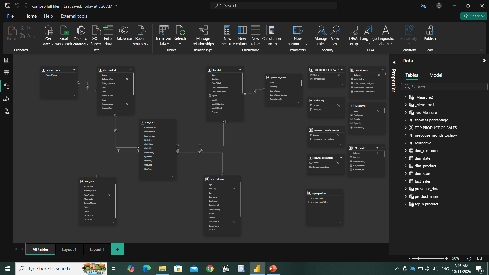
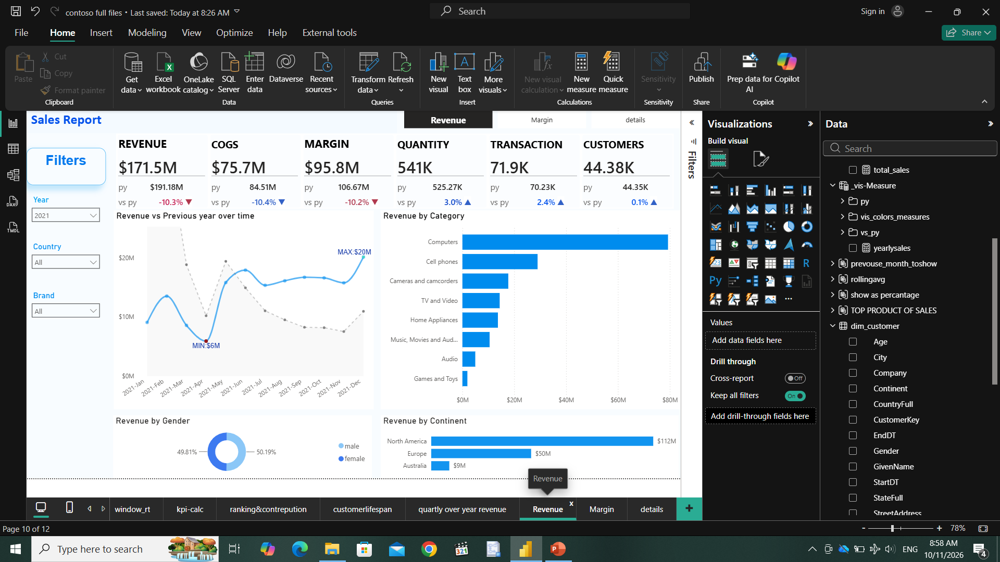
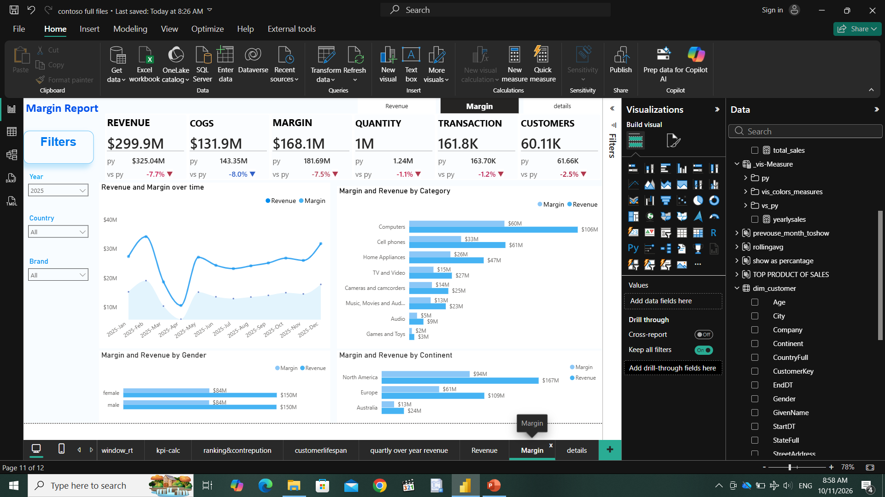
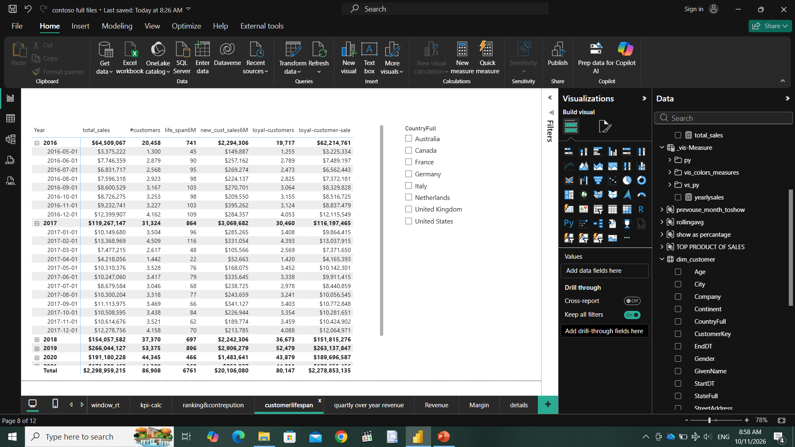
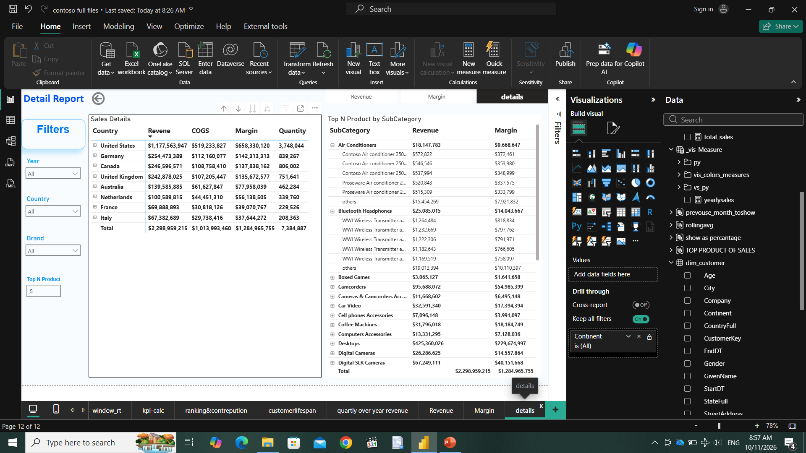
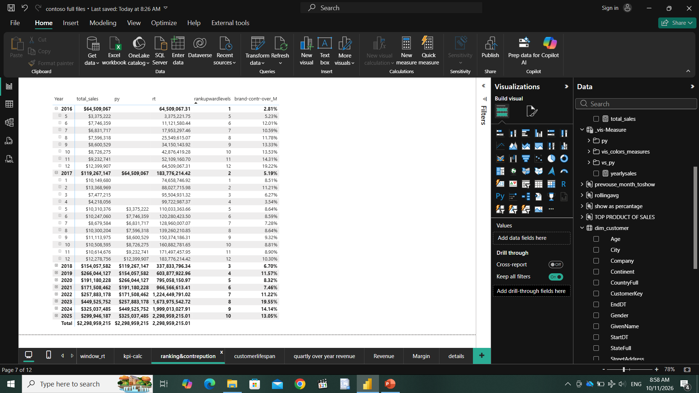
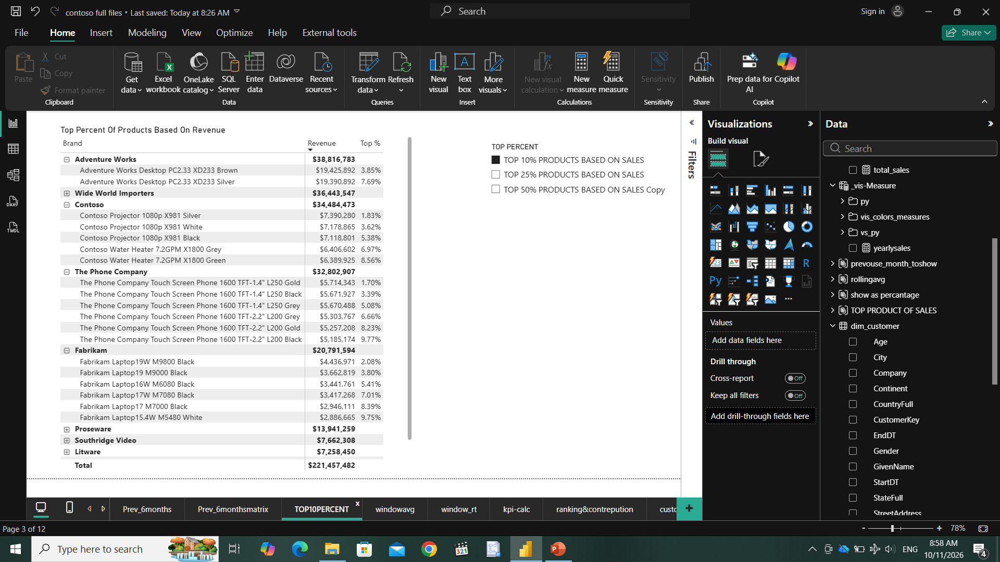

# Contoso Sales & Customer Analytics | Power BI

An end-to-end Power BI portfolio project exploring sales performance, profitability, product and regional results, and customer behavior using dimensional modeling and advanced DAX calculations.

## Project Overview

This project uses the Contoso dataset to build an interactive business intelligence solution. It brings sales and customer information into an analytical model and presents key measures through report pages designed to support business review and decision-making.

## Data Model

The model uses a star-schema approach with sales as the central fact table and related customer, product, store, and date dimensions.

## Analysis & Report Features

- **Sales Overview:** Revenue, cost of goods sold, margin, and year-over-year comparisons.
- **Profitability Analysis:** Margin breakdowns by product category, gender, and geography.
- **Product Analysis:** Interactive detail views and Top N product analysis.
- **Customer Analysis:** Customer lifespan, retention, and cohort-style views.
- **Time Intelligence:** YTD/QTD calculations, prior-period comparisons, and rolling averages.
- **Advanced Measures:** Running totals, rankings, contribution percentages, and dynamic measure presentation.

## Report Previews

## Tools & Technologies

Microsoft Power BI Desktop · DAX · Power Query · Data Modeling · Star Schema · Business Intelligence · Data Visualization · Git & GitHub

## About

Created by **Mohammed Abdo Al Kareem Abalan** as a Power BI business intelligence portfolio project.
